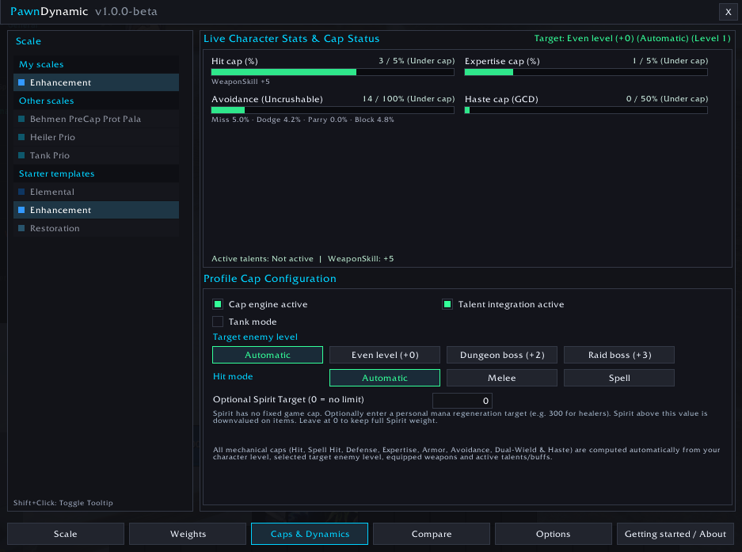

# PawnDynamic

**Author:** Behmen  
**Version:** `1.0.0-beta`  
**Target Client:** World of Warcraft: Classic Forever (Interface `16001`)  
**License:** MIT License (100% clean-room Lua, no XML)

**PawnDynamic** is a modern, dynamic gear evaluation addon for **WoW Classic Forever**. It combines classic Pawn-style profile management and Pawn-v1 string import/export with an automatic, delta-based cap engine, live talent/aura tracking, and a Stat Priority Generator.

> **Beta Status (`v1.0.0-beta`):** `enUS` and `deDE` are verified in-game. Eight additional locales (`frFR`, `esES`, `itIT`, `ptBR`, `ruRU`, `koKR`, `zhCN`, `zhTW`) are included and open for community refinement via `/pd dump`.

---

## Features
* **Automatic Dynamic Cap Engine:** Level- and target-scaled (`+0`, `+2`, `+3`) delta evaluation for Hit (incl. Dual-Wield & Hybrid Hit Mode), Spell Hit, Defense (`Level × 5 + 125/135/140`), Expertise, Armor (`75%` DR), Avoidance (`Uncrushable`), Haste (`50%` GCD), and Magic Resistances (`(Level + Offset) × 5` + optional `+60` Raid Buff offset).
* **Stat Priority Generator:** Turns plain priority lists (including 17+ stats) into item-budget-normalized weights with automatic primary-stat synergies (e.g., Armor → Agility, AP → Strength/Agility) and strict `0`-weighting for irrelevant stats.
* **Talent & Buff Tracking:** Language-independent `C_Traits` / `C_ClassTalents` parsing and `UNIT_AURA` / `UPDATE_SHAPESHIFT_FORM` live updates with strict double-count protection.
* **Pawn-v1 Compatible:** Hardened import/export for simulator strings (e.g., MythicSim) and unlimited custom profiles.
* **UI & Bag/Quest Integration:** Native Lua ElvUI-style 6-tab interface, side-by-side item compare, tooltip scoring, quest reward markers, and bag arrows for Blizzard Bags, Bagnon, and Baganator.
* **Secret-Value Safe:** Full `Plain()` wrapper (`issecretvalue`) and `pcall`-guarded callbacks for zero combat Lua errors on Build `16001`.

<!-- Add screenshots once ready:

-->

---

## Installation
1. Download the latest release ZIP from **[CurseForge](#)** or **[GitHub Releases](#)** *(do not download the raw source repository)*.
2. Extract the `PawnDynamic` folder into:
   `...\World of Warcraft\_forever_\Interface\AddOns\PawnDynamic`
3. Launch the game and type `/pd` to open the interface.

---

## Slash Commands
| Command | Description |
| :--- | :--- |
| `/pd` / `/pawndynamic` | Opens the PawnDynamic UI |
| `/pd status` | Prints current target mode, resolved caps, and session error count |
| `/pd dump` | Dumps parsed tooltip data for the hovered/linked item (helpful for locale reports) |
| `/pd scan` | Forces a full equipped/bag rescan |
| `/pd refresh` | Invalidates caches and refreshes UI/tooltips |
| `/pd debug` | Toggles debug logging |

---

## Contributing & Bug Reports
* **Missing translations or stat phrases:** Hover an affected item, run `/pd dump`, and paste the output into a GitHub Issue.
* **Class/spec cap edge cases:** Include the output of `/pd status` along with your class, spec, and active profile.

---

## Changelog
See [`changelog.md`](changelog.md) for the full version history.